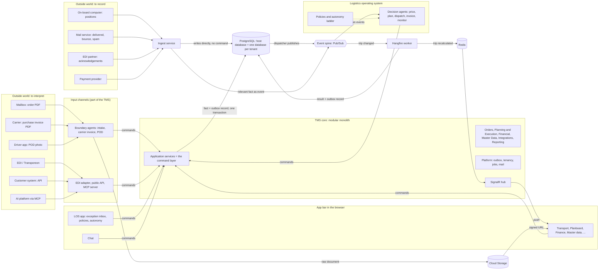

# 01 — Overview

## The one idea

The TMS core does three things: it **accepts commands, writes facts and publishes events**.
It reads no mailbox, calls no language model and takes no operational decision.

Everything else happens around the core:

- **Input channels** turn something from outside into a command.
- **Decision agents** react to events and send new commands, within policies a customer set.
- **People** send the same commands from the screens.

An agent has no back door. It reaches the core through the same application services as a
planner at a screen, with the same validation and permissions.

Why it is built this way: facts and decisions stay apart. A fact is "trip 12 has carrier X".
A decision is "an agent assigned carrier X because of policy P". That split is what lets a
customer turn autonomy up step by step, lets every decision be explained afterwards, and
lets the agent layer be metered and priced separately from the classic TMS.

## Two ways in from the outside world

| The input… | Route | Example |
|---|---|---|
| **needs interpreting** before it means anything | input channel → command | an email with an order PDF |
| **is already a fact** about the world | ingest → recorded → (sometimes) event | a vehicle position, "this email bounced" |

Rule of thumb: what must be interpreted becomes a command right away. What is already a
fact is recorded by ingest. **A business rule never runs inside ingest**: if a report matters,
it becomes an event, and a module or agent reacts to that event with a command.
Details: `02-flows.md` and `07-ingest.md`.

## The picture

The layout of the rendered diagram is automatic and not meaningful. Read it as the list of
connections it is: who sends what to whom.

## Components and how far they are

"Home" names the domain module or runtime role that owns the component.

| Component | What it does | Status | Home |
|---|---|---|---|
| Modular monolith, one ABP module per domain, schema per module | The core's structure | **BUILT** | `backend/modules/*` |
| Application services as conventional controllers | The command layer: validation, permissions, unit of work | **BUILT** (no domain operations yet) | each module |
| Domain entities | The facts | **BUILT** for master data (designs 41–55) and, with designs 56–61, transport orders, legs, trips, price lists and rate lines | each module |
| Host database + database per tenant | Tenant isolation | **BUILT** | Platform, DbMigrator |
| Transactional outbox in every database | Fact and event commit together | **BUILT** (PR #33, `docs/designs/outbox-per-tenant.md`) | Platform |
| Outbox dispatcher over all tenant databases | Publishes stored events | **BUILT** (PR #33); known scale limits, see `03` | Platform + host |
| Event spine on Google Pub/Sub | Carries events to agents and other roles | **DECIDED**, not built: events are still delivered in-process | Platform |
| Hangfire for background work | Recalculation, recurring jobs | **BUILT** inside the single host; storage in the host database | Platform |
| Runtime roles Api / Ingest / Jobs / Agents from one image | Separate scaling per kind of work | **DECIDED**, not built: one host does everything | host |
| Redis | SignalR backplane, shared cache, distributed lock, outbox signal | **PROPOSED**, not built | infrastructure |
| SignalR push to the browser | "Trip recalculated" reaches open screens | **DECIDED**, not built | Api role |
| Documents in Cloud Storage | Blobs leave the database; browser fetches via signed URL | **DECIDED**, not built: `BlobStoring.Database` is still wired | Platform |
| Connection pooler in front of PostgreSQL | Keeps connections bounded with a database per tenant | **OPEN** which one | infrastructure |
| Ingest service | Records facts reported from outside | **DECIDED**, not built | Ingest role; adapters **PROPOSED** in Integrations |
| Boundary agents | Email/PDF/photo → command | **DECIDED**, not built | Agents role |
| Decision agents, policies, autonomy ladder, exception inbox | The operating system, the **LOS** app (AD-19) | **DECIDED** as concept, not built; no domain owns its records yet (**OPEN**, AO-02) | — |
| MCP server and in-app chat | TMS as a source in AI platforms; chat inside the TMS | **PROPOSED** | Api role |
| Metering of agent runs | Token cost per tenant and agent | **PROPOSED** | Platform |
| Routing engine | Distances and drive times | **DECIDED** as a separate service, not built | own service |
| Deployment to Cloud Run | — | Absent on purpose (see `/CLAUDE.md`) | — |

## How the architecture's words map onto this repository

The sessions used generic words. In this repository they mean:

| Architecture term | In opentms-next |
|---|---|
| Command API | The modules' ABP application services, exposed as conventional controllers with one route root per module (`/api/orders/...`). There is **no separate command pipeline** and none should be built. |
| Command | An application-service method that changes data. It runs in a transactional unit of work. |
| Fact | An entity in the owning module's schema. |
| Domain event | An ETO in the publisher's `Domain.Shared/Events`. |
| Contract between modules | A module's `Domain.Shared` and `Application.Contracts` projects. There is no shared `Contracts` assembly. |
| Core modules | Orders, Planning & Execution, Financial, Master Data. Integrations and Reporting sit beside them; Platform is the floor under all. |
| Rates and invoicing | Submodules of Financial, not modules of their own. |
| App bar tile | An entry in `frontend/src/app/apps.config.ts`. Tiles are views on domains, never modules. |

An earlier sketch from the sessions (a `Tms.*` solution with one project per module, a
`Tms.Contracts` assembly and a custom command pipeline) is **superseded** by the structure
above. Ignore it wherever you meet it.
